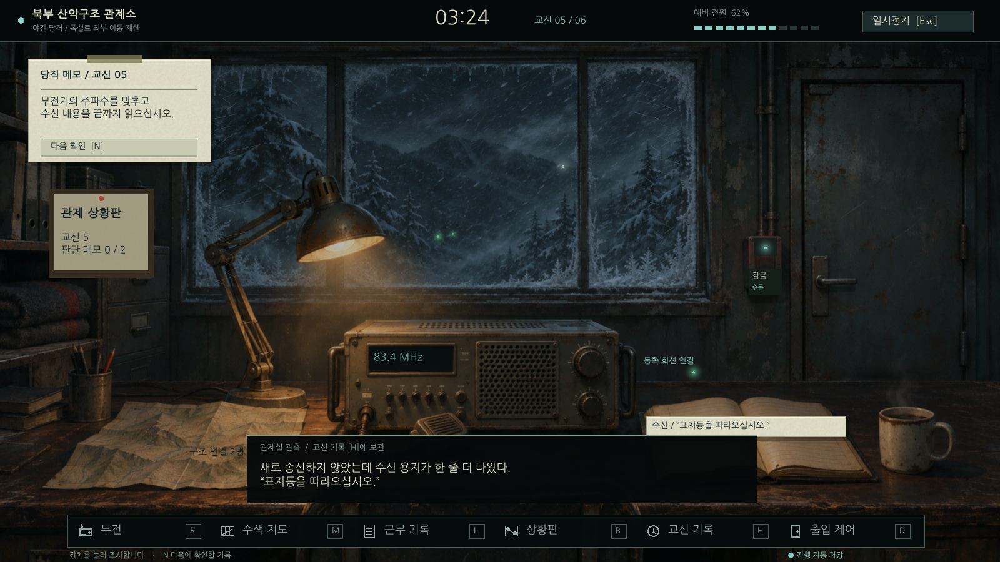

# 마지막 교신 / Last Transmission

[**Windows v0.12.0 다운로드**](https://github.com/pa9904/last-transmission-public/releases/tag/v0.12.0)

ZIP을 풀고 폴더 안의 `LastTransmission.exe`를 실행하세요. 이 저장소는 Unity 프로젝트의 v0.12.0 공개 스냅샷입니다. **소스와 Docs/STORY.md에는 엔딩 스포일러가 있습니다.**


폭설로 고립된 산악 구조 관제소에서 무전, 지도, 근무 기록을 대조하며 구조 경로와 출입을 결정하는 PC용 한국어 2D 공포 추리 게임입니다. 점프 스케어보다 진술의 모순, 반복되는 교신, 문밖의 소리로 긴장을 만듭니다.


현재 버전은 **0.12.0**입니다. 공통 장치 패널과 하단 메뉴의 폭을 맞췄고, 무전 본문을 넓혔으며, SUIT Regular와 Bold를 사용합니다. 무전기 바늘이 수신 강도를 표시하고 다섯 번째 교신의 첫 진술이 끝난 뒤 잠시 멈춥니다. 상황판에서 선택은 연필 체크로, 송신한 판단은 시각 도장으로 표시합니다. 지도는 창의 가로세로 비율에 따라 현장 기록을 옆이나 아래에 배치합니다. [세로 창 화면](Docs/Screenshots/map-portrait-v080.png) 상황판의 진술과 대조 버튼에서 수신한 무전과 근거 기록을 나란히 읽고 Esc로 같은 판단 카드에 돌아옵니다. 모든 버튼은 무음입니다. 일곱 가지 배경 음악이 교신, 기술자 구조, 정문 대치, 결말에 맞춰 같은 박자의 다음 편곡으로 넘어갑니다. 설정의 배경 음악 슬라이더로 음량을 따로 조절할 수 있습니다. 응답을 보관하고 관제실로 돌아오면 창밖의 표지등, 책상등, 출입 제어기의 대기 표시와 문 아래 그림자에서 근무 중 내린 판단의 흔적을 볼 수 있습니다. 관측 문구는 교신 기록(H)에 보관합니다. 무전기(R)는 언제든 다시 열 수 있습니다. 교신 6건, 문서 12개, 상황판 판단 근거 12개, 엔딩 3종. 초회 목표 20~30분이며 사람 대상 플레이 시간 실측은 아직 하지 않았습니다. 빠르게 읽고 진행하면 훨씬 짧습니다. 강제 대기, 시간 초과, 무작위 정답, 중간 즉사는 없습니다. 엔딩에는 실제 이번 근무의 경과 시간이 표시됩니다.



v0.1에서 문서만 열면 답변하던 흐름을 보강했습니다. 상황판에 기록을 대조한 판단 근거를 직접 남기고, 마지막에는 두 색을 섞어 확인등을 세 번 표시한 뒤 각 출입구의 보고를 비교합니다. 기존의 미확인 정문 승인이 누적됐다면 직접 취소해야 합니다. 관제실 바탕은 프로젝트용으로 생성한 배경 원화로 교체했으며 외부 무료 다운로드 에셋과 구분해 기록했습니다.

## Windows 실행

별도 전달되는 `LastTransmission-0.12.0-Windows` 폴더 전체를 유지한 채 `LastTransmission.exe`를 실행하세요. 실행 파일만 다른 위치에 복사하면 작동하지 않습니다. 64비트 Windows용 Mono 빌드입니다. 빌드와 ZIP은 소스 저장소에 넣지 않습니다.

- 마우스: 배경의 장치 또는 하단의 아이콘·장치 이름 클릭. 배경 소품에 마우스를 올리면 설명 표시
- `R`: 무전 / `M`: 지도 / `L`: 근무 기록 / `D`: 출입 제어 / `H`: 교신 기록
- `B`: 상황판에서 현재 교신의 판단 근거 두 가지 정리, 이전 교신의 근거 복기
- `N`: 다음에 확인할 장치·문서로 이동. 판단과 응답은 직접 선택
- `Space`: 문장 즉시 표시, 이미 표시됐으면 다음 수신 문장
- `Esc`: 장치 닫기, 관제실에서 누르면 일시정지. 최종 결정·새 근무 확인창에서는 취소
- 휠: 긴 기록과 교신 본문 스크롤

무전 화면의 수신 주파수를 맞추고 관련 문서를 확인한 뒤 상황판에 근거 두 가지를 남기면 응답할 수 있습니다. 잘못된 해석도 제출할 수 있고, 응답 뒤에 기록 원문과 대조하는 피드백이 남습니다. 단순히 해석이 틀렸다는 이유로 구조 결과를 무작위로 바꾸지는 않습니다. 실제 안내한 경로와 출입 응답이 구조 결과를 결정합니다.

지도에서는 지점이나 이름표를 눌러 오른쪽 현장 기록을 읽습니다. `기록 원문 크게 읽기`로 문서를 확대하고 `M` 또는 `Esc`로 지도로 돌아옵니다. E 정비구 표식을 선택하면 왼쪽 위에 출입 상세도가 나타납니다. 지도는 게임용 지형·경로 개념도이며 거리 비례나 실제 지역의 측량 도면이 아닙니다.

마지막에는 무전으로 독립 관측을 요청한 뒤 출입 제어기에서 빨강·초록을 섞어 세 번 직접 표시합니다. 표시한 순서를 무전으로 말하지 않고, 두 출입구의 보고 중 일치한 것을 선택합니다. 틀린 보고를 채택하면 잠금은 유지되며 다시 비교할 수 있습니다. 정문 사전 승인을 누적했다면 먼저 취소하세요. 최종 문 개방은 별도의 확인창을 거칩니다.

자동 저장: `%USERPROFILE%\AppData\LocalLow\Snowline Studio\Last Transmission\progress.json`. 설정은 같은 폴더의 `settings.json`, 완료한 결말은 `collection.json`. 쓰기 중 임시 파일을 사용하고 직전 정상 파일은 `.bak`으로 보관합니다. 이어하기 슬롯은 하나이며 새 근무로 교체해도 엔딩 기록은 유지됩니다. 이전 버전의 완료된 이어하기 기록도 엔딩 보관철로 가져옵니다.

설정에서 전체·배경 음악·효과음·바람/무전 잡음 음량, 본문 크기 100~130%, 교신 표시 속도와 즉시 표시를 조절합니다. 지도와 근무 기록은 장치를 오가도 마지막 문서와 스크롤 위치를 기억합니다(실행 중). 교신 기록 위쪽 탭에서 이전 교신과 당시 판단 결과를 다시 읽습니다. 게임 창에서 벗어나면 일시정지하고 진행을 저장하며, 돌아와서 직접 재개합니다.

v0.1 저장은 이어하기에서 자동 이관합니다. 이미 마친 교신과 엔딩은 보존하며 진행 중인 마지막 신원 확인은 새 확인등 조작으로 마쳐야 합니다.

## Unity 프로젝트

- **Unity 6000.6.7f1**, revision `b22767f04f04` (이 컴퓨터에 설치된 버전 사용)
- Windows Standalone Build Support 설치 필요
- 기본 내장 렌더링, IMGUI, Mono, .NET Standard, 외부 런타임 패키지 없음
- 사용 모듈: audio / imgui / jsonserialize / imageconversion / screencapture, 각 `1.0.0`
- 실제 의존성: `LastTransmission/Packages/manifest.json`과 `packages-lock.json`

Unity Hub → Add project from disk → `LastTransmission` 폴더를 선택합니다. `Assets/Scenes/ControlRoom.unity`를 열고 Play를 누릅니다. 데이터, 씬, 글꼴, 음향과 `.meta` 파일은 모두 포함되어 있으며 별도의 에셋 로그인이나 다운로드가 필요하지 않습니다.

## 빌드와 검증

PowerShell 7에서:

```powershell
./Tools/Build.ps1
./Tools/Build.ps1 -VerifyOnly
```

기본 Editor 위치가 다르면 `-EditorPath '설치경로/Unity.exe'`를 지정합니다. 빌드 출력은 `Builds/LastTransmission-0.12.0-Windows/`, 로그는 `Artifacts/`. 씬과 플레이어 설정은 `BuildGame.Prepare()`가 재생성합니다.

```powershell
./Tools/VerifyPlayer.ps1
```

명시적으로 실행한 플레이어 검증은 분리된 QA 프로필을 사용하며 3개 엔딩, 저장, 한국어 글리프를 실행한 뒤 종료합니다. 이어서 새 프로세스가 중간 저장과 설정을 불러옵니다. 이 도구는 UI 클릭 테스트를 대신하지 않으며 실제 UI 확인 범위는 [검증 기록](Docs/VERIFICATION.md)에 구분합니다.

## 구조와 콘텐츠 편집

- `Assets/Resources/atmosphere.json`: 교신별 조도·서리·바람·신호와 선택에 따른 관측 문구 및 효과음
- `Assets/Resources/story.json`: 대사, 문서, 선택 결과와 엔딩 데이터
- `Assets/Scripts/StoryModel.cs`: 진행 규칙, 상태, 저장
- `Assets/Scripts/Game.cs`: 관제실 그림, 장치 UI, 음향과 화면 흐름
- `Assets/Scripts/InterfaceUI.cs`: 금속 외함·종이·버튼·장치 아이콘·공통 메뉴, 무전·서류철·출입 콘솔·확인창
- `Assets/Scripts/CaseworkUI.cs`: 원화 배경, 상황판, 수동 확인등과 승인 철회
- `Assets/Scripts/QualityUI.cs`: 조사 안내, 장치 이동, 읽기 설정, 교신·엔딩 보관철
- `Assets/Scripts/MapUI.cs`: 확대 지형도, 경로·지점·출입 상세, 현장 기록과 원문 확대
- `Tools/MakeMapTerrain.cjs`: 외부 패키지 없이 원본 지도 바탕 PNG 재생성 (`node Tools/MakeMapTerrain.cjs`). 일반 실행·빌드에는 Node가 필요하지 않음
- `Assets/Editor/BuildGame.cs`: 씬 생성과 Windows 빌드
- `Assets/Editor/Verification.cs`: 모든 응답 조합과 저장 예외 검증
- `Tools/ExpandStory.cjs`: 현재 이야기의 저작용 원본. Node로 실행하면 JSON과 스포일러 문서 재생성. 일반 플레이/빌드에는 Node가 필요하지 않음

[전체 대사·단서·분기표](Docs/STORY.md)에는 스포일러가 있습니다. [에셋 목록](Docs/ASSETS.md), [크레딧](Docs/CREDITS.md), [환경 기록](Docs/ENVIRONMENT.md)을 별도로 제공합니다.

[메모장용 전체 루트 공략](Docs/마지막_교신_전체_루트_공략_v0.3.0.txt)은 엔딩 3종의 진행 예시, 교신별 모든 선택과 결과, 상황판 정답, 확인등 조작, 무전 응답 조합 729개를 포함합니다. 모든 엔딩의 스포일러가 있습니다. `node Tools/WriteWalkthrough.cjs`로 현재 데이터에서 다시 생성할 수 있습니다.

v0.3.1부터 v0.12.0까지 v0.3.0 공략의 단서·응답·엔딩 조건을 그대로 사용합니다. v0.4에서는 교신의 안내에 맞춰 정비 우회로를 노란 계열 점선으로 표시합니다.

## 알려진 제한과 다음 작업

- 초회 20~30분 목표는 실제 사용자 테스트로 검증해야 합니다. 답을 아는 플레이는 짧습니다.
- 전신 이동, 인벤토리, 성우 음성, 다국어, 컨트롤러, Steam 업적/클라우드 기능은 없습니다.
- 관제실 배경 원화는 프로젝트용 AI 생성 이미지입니다. 생성 출처와 프롬프트를 별도로 기록했으며, 지도와 상황판·확인등 UI는 Unity 그래픽입니다. 자유 이동형 공간은 아닙니다.
- 일부 판단은 후속 대사·기록·구조 인원에 반영되며, 모든 선택이 별도 엔딩을 만들지는 않습니다.
- 마지막 확인등은 실제 조작과 관측 비교를 요구하지만 대화 상대와 경로는 정해진 서사 분기입니다.
- 이어하기는 단일 저장 슬롯입니다. 엔딩 기록은 별도 보관하며, 문서별 스크롤 위치는 실행 중에만 기억합니다.
- 1280×720 이상의 창을 권장합니다. 창 크기가 변하면 화면 배율과 상·하단 메뉴 위치가 바뀝니다. 폭이 높이의 1.12배 미만인 창에서는 지도 아래에 현장 기록을, 무전기 조작부 아래에 녹취를 배치합니다. 장치 메뉴는 두 줄로 표시합니다. [세로 창 무전기 화면](Docs/Screenshots/radio-portrait-v0120.png)
- 입력 직후 Windows 즉시 캡처에서 일부 문구가 빠지고 재관측 시 정상 표시되는 현상이 남아 있습니다. 게임 렌더와 캡처 타이밍 중 원인은 아직 분리하지 못했습니다.
- Steam 출시 전 외부 플레이테스트, 음향 청취/기기별 밸런스, 접근성, 서명/배포 QA, 스토어 이미지·영상·연령 등급·상점 설정을 진행해야 합니다.

프로젝트의 직접 제작 코드·대사·그림은 [MIT](LICENSE), 외부 음향과 글꼴은 각 별도 라이선스를 따릅니다. 이 프로젝트의 MIT 문구가 외부 에셋의 조건을 바꾸지 않습니다.
