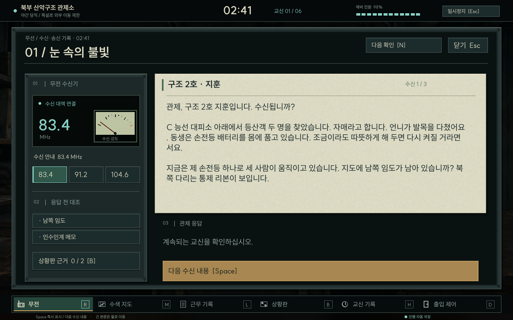

# 마지막 교신 / Last Transmission

폭설로 산길이 끊긴 밤, 산악 구조 관제소에서 혼자 근무를 시작합니다. 첫 무전은 다친 등산객을 구조 차량까지 안내해 달라는 요청입니다. 그러다 새벽 세 시를 넘기자, 실종된 동료가 무전으로 문을 열어 달라고 합니다.

무전으로는 누군가 다리를 건너왔다고 합니다. 그런데 지도에는 이미 무너진 다리라고 표시돼 있습니다. 《마지막 교신》은 이런 엇갈린 이야기를 지도와 근무 기록으로 맞춰 보는 짧은 한국어 공포 추리 게임입니다. 누구를 믿고 어떤 안내를 했는지에 따라 결말이 달라집니다.

[Windows 버전 다운로드](https://github.com/pa9904/last-transmission-public/releases/download/v0.12.0/LastTransmission-0.12.0-Windows-x64.zip) · 압축을 풀고 `LastTransmission.exe`를 실행하면 됩니다.
