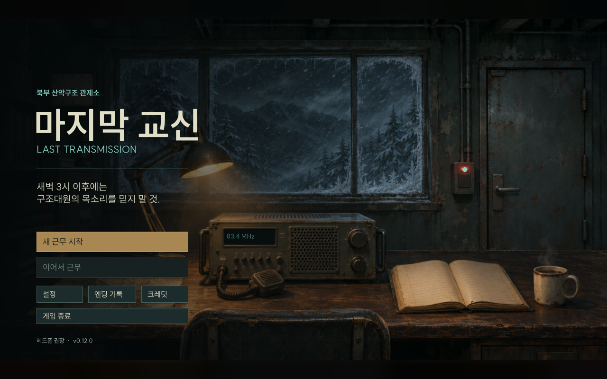

# 마지막 교신 / Last Transmission

폭설에 갇힌 산악 구조 관제소. 전임자가 남긴 메모에는 이렇게 적혀 있습니다.

> 새벽 3시 이후에는 구조대원의 목소리를 믿지 말 것.

잠시 후, 실종된 동료의 목소리가 무전기 너머에서 들려옵니다. 문을 열어 달라고 합니다.

《마지막 교신》은 혼자 야간 근무를 서는 관제원이 되어 플레이하는 짧은 한국어 공포 추리 게임입니다. 무전으로 들은 이야기를 지도와 근무 기록에 대조하고, 누구를 믿을지, 어느 길로 안내할지, 문을 열어도 될지 판단하세요.

[Windows에서 플레이하기](https://github.com/pa9904/last-transmission-public/releases/download/v0.12.0/LastTransmission-0.12.0-Windows-x64.zip) · ZIP을 풀고 `LastTransmission.exe`를 실행하세요.
